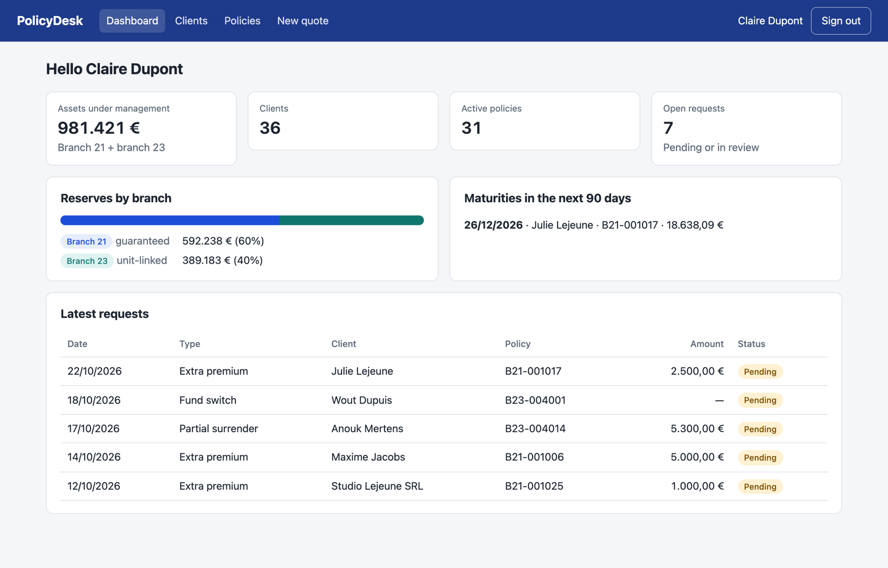
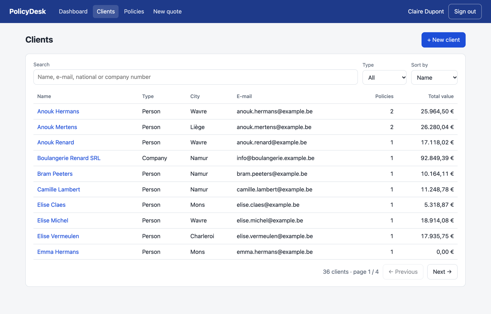
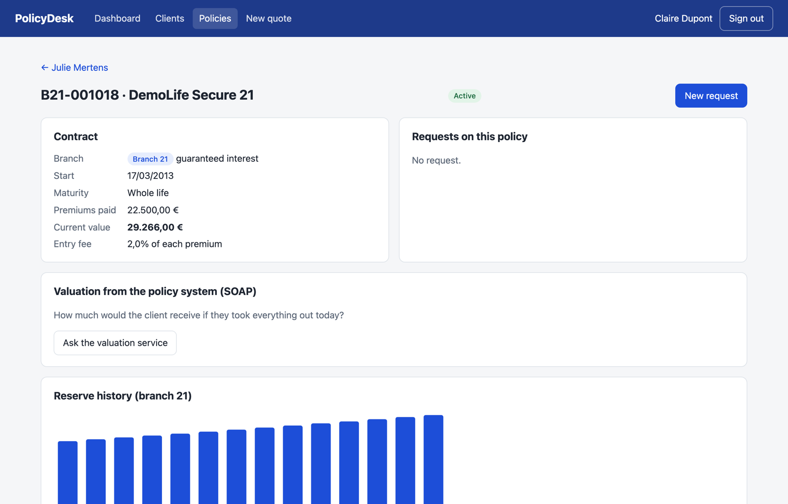
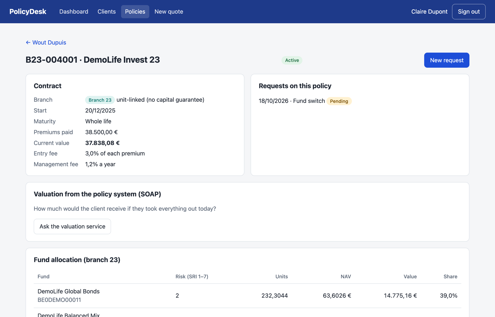
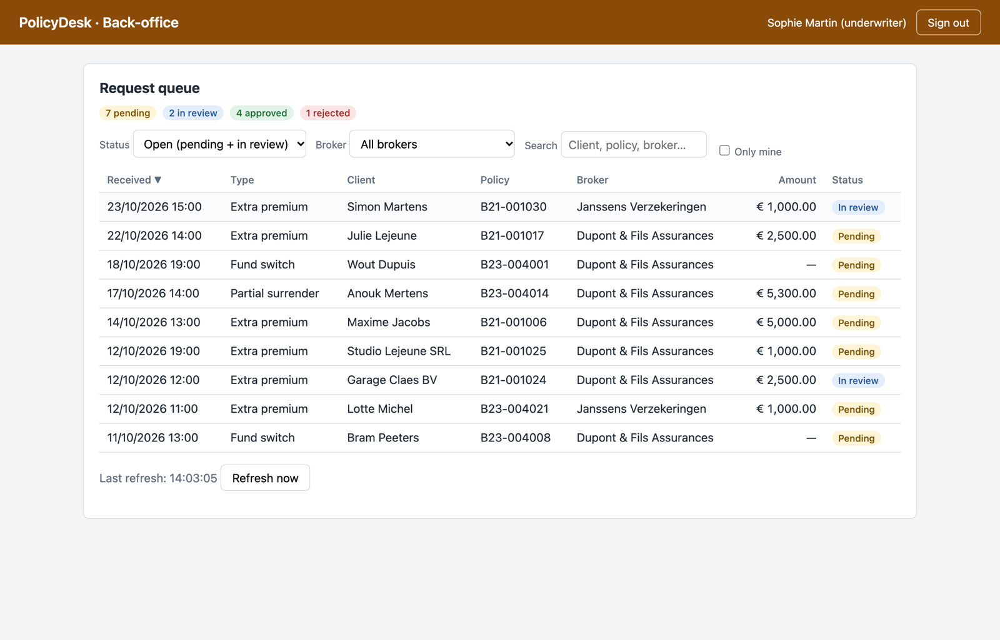
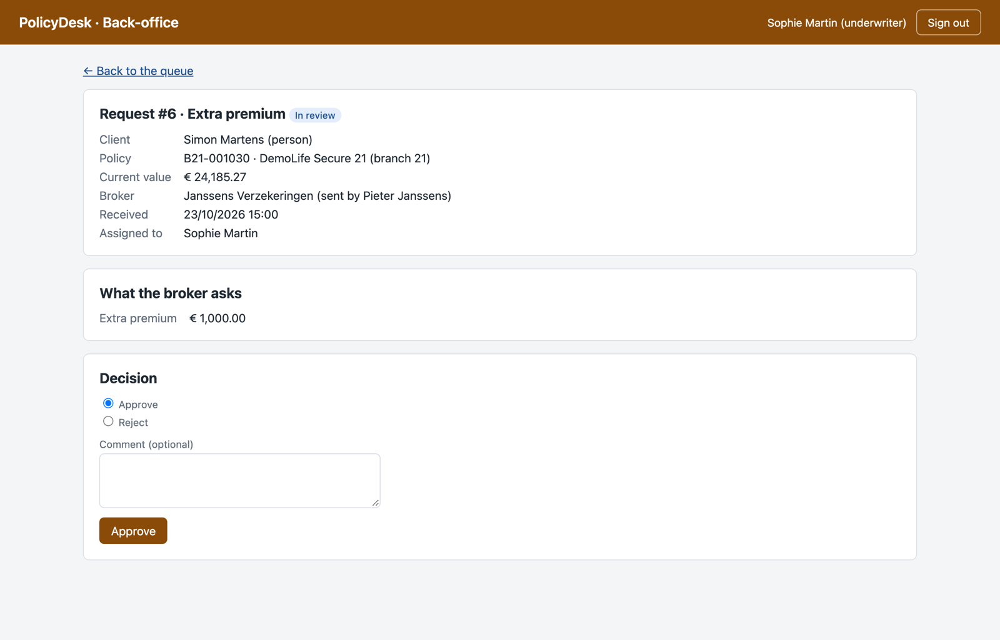
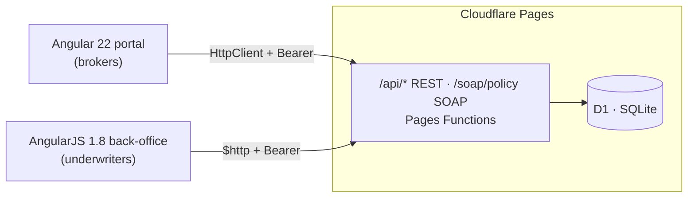

# PolicyDesk

**An exploratory project to discover Angular and AngularJS front-end development**, built around a realistic business
case: a Belgian life insurer selling savings and investment policies (branch 21 and branch 23) through brokers.

The same domain is built **twice**, in both generations of the framework, on one shared API:

- **Broker portal** in **Angular 22** (standalone components, signals, zoneless): clients, policies, a quote wizard and
  policy change requests.
- **Underwriter back-office** in **AngularJS 1.8** (components, services, ui-router): the queue of requests to review,
  take, approve or reject.


**Live demo:** [policydesk-ak9.pages.dev](https://policydesk-ak9.pages.dev/) (portal) and
[/backoffice/](https://policydesk-ak9.pages.dev/backoffice/) (back-office). Demo users are listed under
[Run it locally](#run-it-locally).

<p align="center">
  
  
</p>
<p align="center">
  
  
</p>
<p align="center">
  
  
</p>

All data is generated by a script: names are random combinations of common Belgian first and last names, and the
numbers (national numbers, IBANs, phones) are random values that only pass the format and check-digit rules. They
describe no real person, though a value may match a real one by chance.

## What it explores

| Topic | Angular portal | AngularJS back-office |
| --- | --- | --- |
| Structure | standalone components, feature folders, lazy routes | module, components with `bindings`, factories, IIFEs |
| State | `signal`, `computed`, `effect`, URL as state | `$ctrl`, digest cycle, one-time bindings |
| Data | `HttpClient`, `httpResource`, RxJS (`switchMap`, `debounceTime`) | `$http`, `$q` promises |
| Routing & auth | functional guard, `returnUrl`, functional interceptor | ui-router states, `resolve`, `$transitions`, `$http` interceptor |
| Forms | typed reactive forms, `FormArray`, cross-field and async validators | `ng-model`, `ng-required`, form state |
| Legacy & migration | an NgModule / zone.js-era component next to its modern rewrite; an AngularJS screen ported to Angular | the app to migrate (strangler fig, by route) |
| Integration | a **SOAP** valuation service called from Angular | REST JSON |
| Tests | 80 tests: Vitest, TestBed, `HttpTestingController`, `RouterTestingHarness` | |

Business rules worth a look: Belgian national number, company number and IBAN checks (mod 97), premium tax, branch 21
guaranteed rate vs branch 23 fund units × NAV, and a projection with a risk profile per fund (SRI).

## Architecture



The portal is organised in layers: `core/` (auth, interceptor, guard, models), `shared/` (UI, validators, pipes),
`features/` (one folder per business area) and a pure `domain/` for calculations. Dependencies only point down. Both
front ends know only the API contract ([API.md](API.md)).

## Run it locally

Requirements: Node 24.

```bash
npm ci && (cd portal && npm ci)
npm run db:reset        # local database with demo data
npm run api             # API + back-office on http://localhost:8788
cd portal && npm start  # portal on http://localhost:4200
```

Demo users (password `demo`): `dupont` and `janssens` (brokers, portal), `martin` (underwriter, back-office).

| Script | What it does |
| --- | --- |
| `cd portal && npm run check` | Format check, build and tests |
| `npm run smoke` | Smoke tests against the running API |

## Author

Built by [**Vincicent**](https://github.com/Vincicent), coming from React / React Native and Kotlin, to learn Angular
and AngularJS from the first component to a deployed app.
